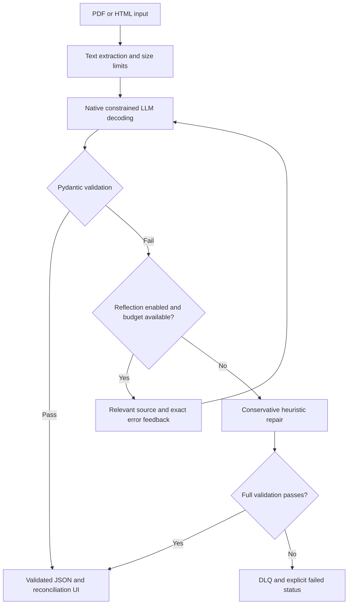

# Resilient Structured Data Extractor

John Nelson - AD 331 Artificial Intelligence - Week 4 hands-on assignment.

Commercial invoice extraction with Pydantic v2, native OpenAI Structured
Outputs, bounded reflection retries, heuristic repair, and dead-letter queue
review. **Current milestone: Step 2 AI-generated baseline, pending Step 3 audit.**
The provider adapter, document ingestion, reflection/repair/DLQ pipeline, CLI and
synthetic samples are implemented and smoke-tested offline. Live OpenAI calls,
the web UI, full QA, and Docker deployment remain unverified or unimplemented.
`src/app.py` remains an explicit Step 4 placeholder.

## Architecture and data flow

This diagram describes the pipeline. CLI output supplies the current display;
the interactive UI will be added in Step 4.



## Windows setup with uv

In PowerShell, from the parent folder in which you keep GitHub projects:

```powershell
git clone https://github.com/JohnNelson858/AD331-structured-data-extractor.git
cd AD331-structured-data-extractor
uv sync --locked
uv run python --version
uv run pytest -v
```

`.python-version` selects Python 3.11. uv can download the interpreter when
needed. The committed `uv.lock` fixes dependency versions. Do not run `uv init`
again inside this prepared checkout or create a second nested project.

No key is needed for schema tests or the labeled offline demonstrations. Later,
copy `.env.example` to `.env` and enter a key locally. Never paste credentials
into chat, commit them, show them in a recording, or print them in a test log.
API requests are separately billed. Default tests and `--demo` make no paid calls.

## Current schema specification

Schema version: `1.0.0`. Domain: single-currency commercial invoices without
discounts or credit notes. All object models reject unknown fields and apply
strict validation, with only the documented pre-parsers allowing normalization.

| Model / field | Type and constraint |
| --- | --- |
| LineItem.description | Nonempty string, maximum 500 characters |
| LineItem.quantity | Strict integer 1 through 1,000,000; no strings, booleans or floats |
| LineItem.unit_price | Decimal, greater than zero, at most 1 billion, at most 2 decimal places |
| LineItem.line_total | Nonnegative Decimal, same monetary limits |
| InvoiceExtraction.invoice_number | 1-64 ASCII letters/digits plus `.`, `_`, `/`, `-`; starts with letter/digit |
| vendor_name | Nonempty string, at most 200 characters |
| invoice_date | Date, normalized to ISO-8601 on JSON export |
| line_items | 1-100 nested LineItem objects |
| subtotal / tax_amount | Nonnegative Decimal, same monetary limits |
| total_amount | Positive Decimal, same monetary limits |
| currency | Exactly USD, EUR or GBP |
| tax_rate_percent | Optional Decimal in 0-100, at most 2 decimal places |

Field pre-parsers accept decimal-point amounts, conventional thousands grouping,
and one leading currency symbol (for example `$1,249.50`). The invoice validator
rejects a symbol inconsistent with the declared currency. Ambiguous
decimal-comma formats are rejected rather than guessed. JSON float inputs are
converted via their decimal string, not their binary representation. Decimal
money serializes as JSON strings intentionally to preserve exact values.

Dates accept `YYYY-MM-DD` or an explicit English month such as
`12th of Oct, 2024`; ambiguous `12/10/2024` is rejected. Tax percentages may have
a trailing `%`. Supported normalization changes representation, never missing
amounts or required identifiers.

Cross-field validators independently check, with **inclusive 0.02 tolerance**:

- quantity multiplied by unit price against each line total;
- sum of line totals against subtotal;
- subtotal plus tax against grand total;
- sum of line totals plus tax against grand total;
- when supplied, declared percentage against tax using half-up cent rounding.

Real multi-rate taxes, discounts, locale-specific rounding, and fractional
quantities require a new explicit domain policy. These models establish an
acceptance contract, not proof of source accuracy. A later provider wire schema
will use its supported strict subset and feed this richer business validator.
JSON object mode alone will not be represented as constrained schema decoding.

## Execution commands

Available now:

```powershell
uv run pytest -v
uv run python -c "from src.schemas import InvoiceExtraction; print(InvoiceExtraction.model_json_schema())"
```

Step 2 baseline demonstrations (no key, no API charges):

```powershell
uv run python -m src.cli --demo success --summary
uv run python -m src.cli --demo reflection --summary
uv run python -m src.cli --demo dlq --summary
uv run python -m src.cli --demo heuristic --no-reflection --summary
```

Omit `--summary` to see raw responses, exact correction messages, structured
Pydantic errors (`loc`, `msg`, `type`), and stage events. Simulations use fixed
responses and fault injection, clearly labeled in the CLI. They demonstrate the
pipeline logic, not model extraction quality or a schema-constrained provider
emitting malformed JSON. `--input samples/vendor_contract.html` exercises HTML.

`max_retries=3` allows one initial call plus three more. Reflection disabled
allows one call. Errors, refusal, and incomplete output never become success.
The baseline caps source characters, correction context, response characters,
output tokens, requests and execution time. Transient failures use backoff with
jitter. Heuristic repairs allow only fences/trailing commas and must pass full
validation. Heuristic recovery has its own explicit status.

DLQ records are written atomically under ignored `runtime/dlq` and include a
source hash/excerpt, failed payload, versions, attempts, and errors. Common API
key shapes are redacted, but this is not general PII anonymization. Use only the
synthetic samples for recordings. A storage failure returns `DLQ_WRITE_FAILED`
rather than claiming the record was saved. Local privacy and deployment-volume
policies need review in subsequent steps.

PDF input supports text layers, at most 5 MB and 10 pages. Pages without usable
text are rejected with an OCR-required explanation. HTML scripts/styles are
removed without executing code, fetching URLs, or treating that removal as a
prompt-injection security guarantee. Native decoding uses `json_schema` and
`strict: true`; provider wire models remain separate from business validators.

The web application command and Docker instructions will be added when those
features exist. See [assignment_progress.md](docs/assignment_progress.md)
for the full rubric mapping and [step1_verification.md](docs/step1_verification.md)
for checks and the pending Dell verification.

## AI audit log summary

The student provided the assignment and requested one-step-at-a-time support.
ChatGPT/Codex created the schema and Step 2 baseline. The actual user
instructions and design decisions are recorded in [ai_prompt_log.md](ai_prompt_log.md).
The Step 2 Git commit preserves the generated baseline before Step 3 records
genuine findings, corrections, and regression evidence. Step 1 was verified on
the Dell: Python 3.11.17, 32 passed in 1.03s. Step 2 smoke checks passed in the
assistant environment: 44 tests. Live extraction and deployment remain pending.
See [step2_verification.md](docs/step2_verification.md) for exact scope and results.
