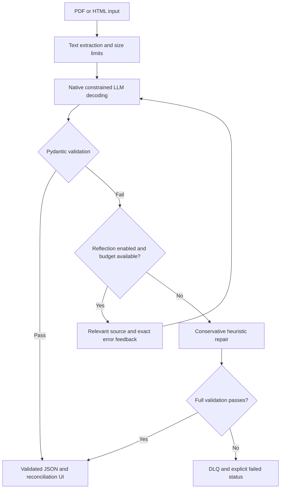

# Resilient Structured Data Extractor

John Nelson - AD 331 Artificial Intelligence - Week 4 hands-on assignment.

Commercial invoice extraction with Pydantic v2, native OpenAI Structured
Outputs, bounded reflection retries, heuristic repair, and dead-letter queue
review. **Current milestone: Step 1, environment and schema definition only.**
The provider engine, document ingestion, web UI, and Docker deployment are not
implemented yet. Files with only module docstrings are explicit future-step
placeholders, not functioning features.

## Architecture and data flow

This diagram is the planned architecture. Only the Pydantic acceptance contract
is implemented in Step 1.



## Windows setup with uv

In PowerShell, from the parent folder in which you keep GitHub projects:

```powershell
git clone https://github.com/JohnNelson858/AD331-structured-data-extractor.git
cd AD331-structured-data-extractor
uv sync --locked
uv run python --version
uv run pytest -v
```

`.python-version` selects Python 3.11. uv can download the interpreter when
needed. The committed `uv.lock` fixes dependency versions. Do not run `uv init`
again inside this prepared checkout or create a second nested project.

No key is needed for the Step 1 schema tests. When the provider engine is ready,
copy `.env.example` to `.env` and enter a key locally. Never paste credentials
into chat, commit them, show them in a recording, or print them in a test log.
API requests are separately billed; no real provider requests run in Step 1.

## Current schema specification

Schema version: `1.0.0`. Domain: single-currency commercial invoices without
discounts or credit notes. All object models reject unknown fields and apply
strict validation, with only the documented pre-parsers allowing normalization.

| Model / field | Type and constraint |
| --- | --- |
| LineItem.description | Nonempty string, maximum 500 characters |
| LineItem.quantity | Strict integer 1 through 1,000,000; no strings, booleans or floats |
| LineItem.unit_price | Decimal, greater than zero, at most 1 billion, at most 2 decimal places |
| LineItem.line_total | Nonnegative Decimal, same monetary limits |
| InvoiceExtraction.invoice_number | 1-64 ASCII letters/digits plus `.`, `_`, `/`, `-`; starts with letter/digit |
| vendor_name | Nonempty string, at most 200 characters |
| invoice_date | Date, normalized to ISO-8601 on JSON export |
| line_items | 1-100 nested LineItem objects |
| subtotal / tax_amount | Nonnegative Decimal, same monetary limits |
| total_amount | Positive Decimal, same monetary limits |
| currency | Exactly USD, EUR or GBP |
| tax_rate_percent | Optional Decimal in 0-100, at most 2 decimal places |

Field pre-parsers accept decimal-point amounts, conventional thousands grouping,
and one leading currency symbol (for example `$1,249.50`). The invoice validator
rejects a symbol inconsistent with the declared currency. Ambiguous
decimal-comma formats are rejected rather than guessed. JSON float inputs are
converted via their decimal string, not their binary representation. Decimal
money serializes as JSON strings intentionally to preserve exact values.

Dates accept `YYYY-MM-DD` or an explicit English month such as
`12th of Oct, 2024`; ambiguous `12/10/2024` is rejected. Tax percentages may have
a trailing `%`. Supported normalization changes representation, never missing
amounts or required identifiers.

Cross-field validators independently check, with **inclusive 0.02 tolerance**:

- quantity multiplied by unit price against each line total;
- sum of line totals against subtotal;
- subtotal plus tax against grand total;
- sum of line totals plus tax against grand total;
- when supplied, declared percentage against tax using half-up cent rounding.

Real multi-rate taxes, discounts, locale-specific rounding, and fractional
quantities require a new explicit domain policy. These models establish an
acceptance contract, not proof of source accuracy. A later provider wire schema
will use its supported strict subset and feed this richer business validator.
JSON object mode alone will not be represented as constrained schema decoding.

## Execution commands

Available now:

```powershell
uv run pytest -v
uv run python -c "from src.schemas import InvoiceExtraction; print(InvoiceExtraction.model_json_schema())"
```

The web application command and Docker instructions will be added only when
those features exist. See [assignment_progress.md](docs/assignment_progress.md)
for the full rubric mapping and [step1_verification.md](docs/step1_verification.md)
for checks and the pending Dell verification.

## AI audit log summary

The student provided the assignment and requested one-step-at-a-time support.
ChatGPT/Codex created this Step 1 schema and scaffolding. The actual user
instructions and design decisions are recorded in [ai_prompt_log.md](ai_prompt_log.md).
Step 2 will preserve the generated extractor baseline before Step 3 records
genuine audit findings, corrections, and regression evidence. No audit bugs,
live extraction, student review, or deployment results are claimed in advance.
